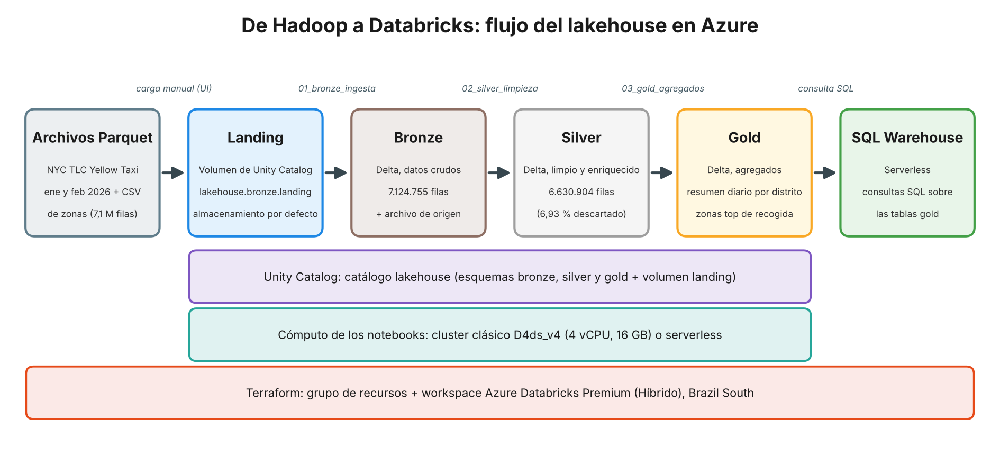
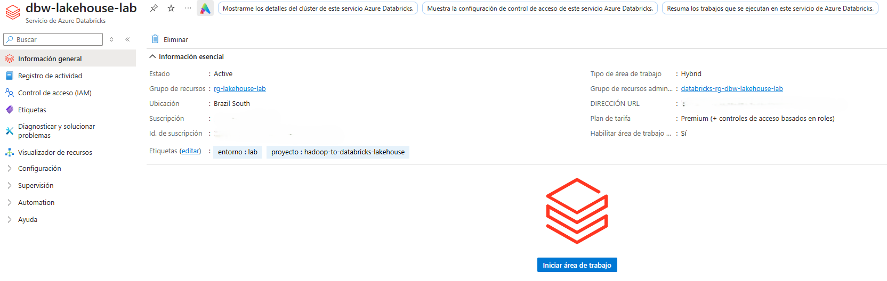
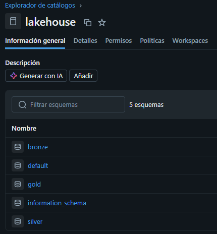
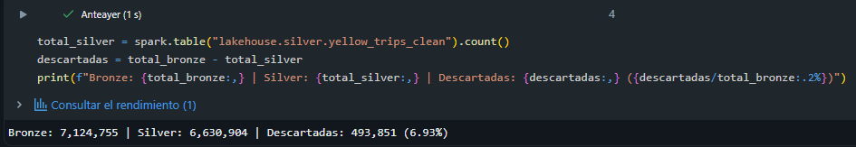
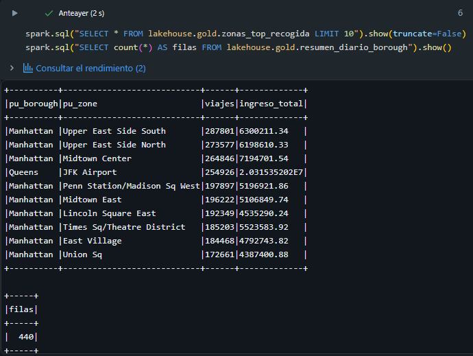
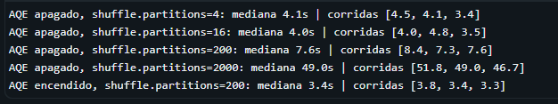
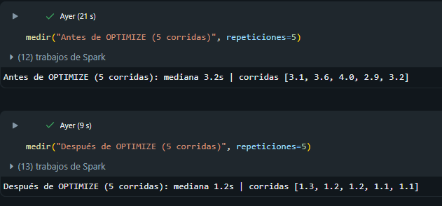
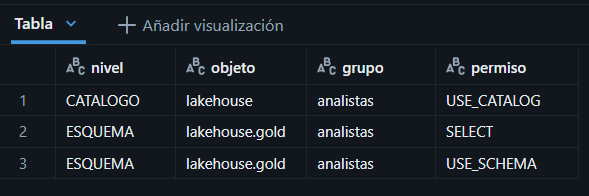
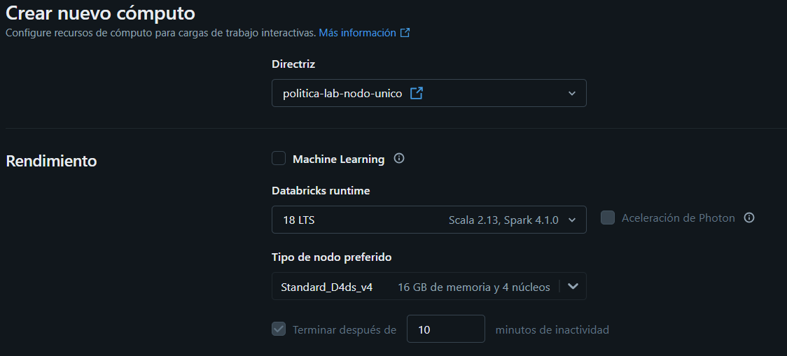
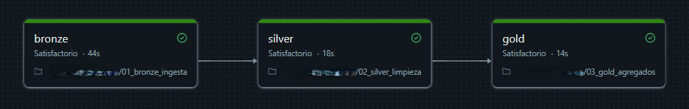

# De Hadoop a Databricks: lakehouse en Azure con Terraform

Proyecto práctico que lleva un flujo de datos al estilo Hive/HDFS hacia un **lakehouse en Azure Databricks**, con la infraestructura definida como código (Terraform), una arquitectura de capas **bronze / silver / gold** sobre tablas Delta, y mediciones de rendimiento hechas con criterio de administrador de plataformas.

Nace de mi experiencia de más de 12 años administrando clusters Hadoop y Cloudera (on-premises e IaaS en Azure): quise comprobar en la práctica cómo se traducen esos conceptos (YARN, HDFS, Hive Metastore, tuning de Spark) a Databricks.

---

# Contenido

1. [Arquitectura](#arquitectura)
2. [Infraestructura (Terraform)](#infraestructura-terraform)
3. [Restricciones de la suscripción y decisiones](#restricciones-de-la-suscripción-y-decisiones)
4. [Datos y pipeline](#datos-y-pipeline)
5. [Mediciones de rendimiento](#mediciones-de-rendimiento)
6. [Gobierno, política de cómputo y orquestación](#gobierno-política-de-cómputo-y-orquestación)
7. [Equivalencias Hadoop a Databricks](#equivalencias-hadoop-a-databricks)
8. [Lo que no se hizo y límites](#lo-que-no-se-hizo-y-límites)
9. [Cómo reproducirlo](#cómo-reproducirlo)
10. [Estructura del repositorio](#estructura-del-repositorio)

---

# Arquitectura

Los archivos Parquet de origen se simulan como una tabla Hive particionada (un archivo por mes). Llegan a una zona de aterrizaje y pasan por tres capas de tablas Delta gobernadas por Unity Catalog.



| Capa | Esquema | Contenido |
|---|---|---|
| Aterrizaje | `lakehouse.bronze.landing` (volumen) | Archivos originales |
| Bronze | `lakehouse.bronze` | Datos crudos en Delta, con el archivo de origen de cada fila |
| Silver | `lakehouse.silver` | Datos limpios, validados y enriquecidos con las zonas |
| Gold | `lakehouse.gold` | Agregados listos para consumo |

---

# Infraestructura (Terraform)

Terraform crea el grupo de recursos y el workspace de Azure Databricks. El catálogo, los esquemas, las tablas, los permisos, la política de cómputo y el job se crearon después desde el propio workspace y están documentados en [`docs/`](docs/).

| Elemento | Valor |
|---|---|
| Proveedor | `azurerm` ~> 4.0 (Terraform >= 1.5) |
| Región | Brazil South |
| Workspace | Azure Databricks, plan **Premium**, tipo **Híbrido** |
| Catálogo | `lakehouse`, con almacenamiento por defecto |
| Cómputo clásico | Nodo único `Standard_D4ds_v4` (4 vCPU, 16 GB), runtime 18 LTS (Spark 4.1.0), Photon apagado, terminación automática a los 10 minutos |

Se eligió **Premium** porque Unity Catalog lo requiere, y el modo **Híbrido** para poder usar clusters clásicos (donde sí se puede ajustar la configuración de Spark), a diferencia del cómputo serverless.



Los archivos están en la carpeta [`terraform/`](terraform/): `versions.tf`, `variables.tf`, `main.tf`, `outputs.tf` y `.terraform.lock.hcl` (que fija la versión del proveedor para que el resultado sea reproducible). El archivo de estado y los identificadores de la suscripción **no** se publican; la suscripción se pasa por variable de entorno.

---

# Restricciones de la suscripción y decisiones

La suscripción tenía regiones limitadas por política y cuotas bajas, así que antes de desplegar hubo que averiguar **dónde se podía realmente encender un cluster**. El detalle completo, con los comandos y resultados, está en [`docs/restricciones-y-decisiones.md`](docs/restricciones-y-decisiones.md). Resumen:

- **Cuota regional de 6 vCPU** en total, y 4 vCPU por familia de máquinas antigua. Las familias modernas (v5 a v7) tenían cuota cero.
- En West US 2, North Central US y Mexico Central, ninguna de las máquinas de 4 vCPU evaluadas estaba disponible para la suscripción (por ejemplo, `Standard_D4s_v3` aparece como `NotAvailableForSubscription`).
- **Brazil South** y Chile Central sí permitían máquinas de 4 vCPU. Se eligió Brazil South (Chile Central quedó de respaldo).
- Validación: un cluster de nodo único arrancó y ejecutó `spark.range(1000000).count()`.

**Consecuencia:** solo puede haber un cluster de 4 vCPU encendido a la vez, y no es posible demostrar clusters multinodo.

Es un ejercicio de *capacity planning*: descubrir los límites con la CLI (`az vm list-usage`, `az vm list-skus --all`) antes de diseñar, en lugar de descubrirlos a mitad del despliegue.

---

# Datos y pipeline

**Fuente:** datos abiertos de la NYC Taxi & Limousine Commission (TLC): viajes de taxis amarillos de **enero y febrero de 2026** (Parquet) y la tabla de zonas de taxi (CSV). Ocupan unos 120 MB en origen y 7,1 millones de filas.

Los notebooks están en [`notebooks/`](notebooks/):

| Notebook | Qué hace |
|---|---|
| `01_bronze_ingesta` | Lee los Parquet y el CSV y los guarda como tablas Delta, conservando el archivo de origen de cada fila |
| `02_silver_limpieza` | Limpia, valida y enriquece con las zonas de origen y destino |
| `03_gold_agregados` | Calcula resúmenes por día y distrito, y zonas con más recogidas |
| `04_mediciones_tuning` | Experimento de particiones de shuffle y AQE |
| `05_archivos_pequenos` | Experimento del problema de archivos pequeños y `OPTIMIZE` |

Los notebooks 01 a 03 corrieron en cómputo **serverless** y los notebooks 04 y 05 en el cluster clásico de nodo único.




## Bronze

- 7.124.755 filas en `lakehouse.bronze.yellow_trips`, en formato Delta, repartidas en 2 archivos (uno por mes de origen) y unos 112 MB.
- Se agrega la columna `_source_file` para conservar el rastro de origen.

## Silver: reglas de limpieza

| Regla | Motivo |
|---|---|
| Fechas de recogida y de bajada no nulas | Sin fechas no se puede calcular la duración |
| Recogida entre el 1 de enero y el 28 de febrero de 2026 | Estos archivos pueden traer registros con fechas fuera del período |
| Duración entre 1 y 180 minutos | Descarta viajes de cero segundos o de días |
| Distancia entre 0,1 y 100 millas | Descarta registros imposibles |
| Tarifa y total mayores que cero | Descarta cancelaciones y errores |
| Pasajeros entre 1 y 6, o nulo | Algunos proveedores no reportan el dato; se aceptan nulos |


**Resultado del control de calidad:** bronze 7.124.755 filas, silver 6.630.904, descartadas **493.851 (6,93 %)**.



## Gold

- `lakehouse.gold.resumen_diario_borough`: viajes, distancia y duración promedio, ingreso total y propina promedio por día y distrito (440 filas). La propina se calcula solo para pagos con tarjeta, porque las propinas en efectivo no se registran en este dataset y sesgarían el promedio hacia abajo.
- `lakehouse.gold.zonas_top_recogida`: zonas ordenadas por número de viajes.



---

# Mediciones de rendimiento

Condiciones comunes: cluster clásico de nodo único `Standard_D4ds_v4` (4 vCPU, 16 GB), runtime 18 LTS, Photon apagado, una consulta fija y una sola variable cambiando por experimento. Cada medición usa un calentamiento previo que no cuenta y se reporta la **mediana** de las corridas, porque se ve menos afectada por una corrida atípica que el promedio.

## Experimento 1: particiones de shuffle y AQE

Consulta: viajes y tarifa promedio por pareja de zona de recogida y zona de destino, sobre 6,6 millones de filas de `silver.yellow_trips_clean`. La consulta se ejecuta con formato `noop` (se calcula todo, pero no se escribe el resultado), para medir el cómputo y no la escritura.

| Configuración | Mediana | corridas (s) |
|---|---|---|
| AQE apagado, 4 particiones | 4,1 s | 4,5 / 4,1 / 3,4 |
| AQE apagado, 16 particiones | 4,0 s | 4,0 / 4,8 / 3,5 |
| AQE apagado, 200 particiones | 7,6 s | 8,4 / 7,3 / 7,6 |
| AQE apagado, 2000 particiones | 49,0 s | 51,8 / 49,0 / 46,7 |
| **AQE encendido, 200 particiones** | **3,4 s** | 3,8 / 3,4 / 3,3 |

**Lectura:** con solo 4 núcleos, demasiadas particiones de shuffle perjudican mucho: con 200 hay unas 50 tareas por núcleo y con 2000 unas 500, así que el tiempo se va en planificar y lanzar tareas diminutas y no en procesar datos. Es el mismo problema conocido de YARN: demasiados contenedores pequeños para un trabajo que cabe en pocos. AQE con el valor por defecto fue la mejor configuración, porque agrupa las particiones pequeñas en tiempo de ejecución y evita tener que adivinar el número correcto.

**Resultado:** la diferencia entre AQE (3,4 s) y 4 o 16 particiones (4,0 s) es pequeña, con solo 3 corridas y rangos que casi se tocan, así que no la considero concluyente. Lo claro es que 200 y sobre todo 2000 particiones son peores.




## Experimento 2: archivos pequeños y OPTIMIZE

Se creó una copia de la tabla silver fragmentada en 400 archivos (unos 440 KB cada uno) y se midió una consulta de filtro y agregación (viajes de Manhattan por día). Después se ejecutó `OPTIMIZE`, que une los archivos pequeños en archivos grandes, y se midió de nuevo. El caché de disco de Databricks se desactivó para que no escondiera el efecto. Ambas mediciones usaron 5 corridas, hechas seguidas en la misma sesión.

| | Archivos | Tamaño | Mediana | corridas (s) |
|---|---|---|---|---|
| Antes de `OPTIMIZE` | 400 | ~168 MB | 3,2 s | 3,1 / 3,6 / 4,0 / 2,9 / 3,2 |
| Después de `OPTIMIZE` | 3 | ~151 MB | **1,2 s** | 1,3 / 1,2 / 1,2 / 1,1 / 1,1 |

**Lectura:** la consulta quedó unas 2,7 veces más rápida, y los rangos de las dos mediciones no se solapan, por lo que la mejora no se explica por ruido. Es el problema de archivos pequeños de HDFS visto en Delta: cada archivo hay que abrirlo y planificarlo, y con cientos de archivos diminutos el tiempo se va en eso. Además, la tabla pesó cerca de un 10 % menos al comprimirse mejor en archivos grandes.




## Límites de las mediciones

- Una sola consulta por experimento, una sola tabla y un cluster de 4 núcleos: las conclusiones sirven para este tamaño de datos y de cluster, no son una regla general.
- **Variabilidad entre sesiones:** el tiempo base de la consulta fragmentada fue de 4,9 s en una primera medición de 3 corridas y de 3,2 s en la de 5 corridas, con la misma tabla y sin cambios. Por eso solo se comparan mediciones hechas seguidas en la misma sesión.
- No se probó Z-ORDER ni clustering: con una tabla de unos 150 MB el efecto sería poco visible.
- Con 4 núcleos no se puede demostrar el efecto de escalar el número de nodos.

---

# Gobierno, política de cómputo y orquestación

## Permisos en Unity Catalog

Se creó el grupo `analistas` (a nivel de cuenta) y se le dieron los permisos mínimos para leer los agregados:

- `USE CATALOG` sobre `lakehouse`.
- `USE SCHEMA` y `SELECT` sobre `lakehouse.gold`.

No tiene acceso a `bronze` ni a `silver`: es el principio de mínimo privilegio. Se verificó con `SHOW GRANTS`, y en esa revisión apareció `BROWSE` sobre el catálogo para el grupo `account users`, que no asigné yo (parece un permiso por defecto). Los comandos están en [`docs/sql/unity-catalog.sql`](docs/sql/unity-catalog.sql).

**Límite:** la cuenta tiene un solo usuario real, así que no probé el acceso de una segunda persona.



## Cluster policy

La política `politica-lab-nodo-unico` ([`docs/cluster-policy.json`](docs/cluster-policy.json)) limita lo que se puede crear:

| Regla | Valor |
|---|---|
| Tipo de nodo | Solo `Standard_D4ds_v4` o `Standard_D4s_v4` |
| Workers | 0 (nodo único), por la cuota de 6 vCPU |
| Autoterminación | Entre 5 y 30 minutos (10 por defecto) |
| Photon | Apagado (bloqueado) |
| Etiqueta de costo | `proyecto` fija |

En el formulario de creación comprobé que solo ofrece esos dos nodos y que Photon queda bloqueado. No creé un cluster con la política en ejecución.

**Sobre la equivalencia con YARN:** es parcial. Una cola de YARN reparte capacidad entre usuarios, mientras que una cluster policy limita qué configuración se puede crear.



## Workflow

El job `pipeline-taxi-lakehouse` ejecuta en cadena `bronze` → `silver` → `gold` sobre cómputo serverless ([`docs/workflow-job.json`](docs/workflow-job.json)).

- Una ejecución exitosa: bronze 44 s, silver 18 s, gold 14 s.
- **Es idempotente:** tras reejecutarlo, `silver` siguió con 6.630.904 filas, y el historial de Delta muestra una versión nueva en vez de datos duplicados.
- **Límites:** no tiene programación, reintentos ni alertas, y solo se ejecutó una vez.



---

# Equivalencias Hadoop a Databricks

| Hadoop / Cloudera | Databricks en este proyecto | Estado |
|---|---|---|
| HDFS | Almacenamiento cloud + tablas Delta (almacenamiento por defecto del catálogo) | Hecho |
| Tabla Hive particionada | Tabla Delta en Unity Catalog (`catálogo.esquema.tabla`) | Hecho |
| Hive Metastore | Unity Catalog | Hecho (catálogo y esquemas) |
| `mapreduce.job.reduces` / reducers | `spark.sql.shuffle.partitions` y AQE | Medido (experimento 1) |
| Problema de archivos pequeños en HDFS | Compactación con `OPTIMIZE` | Medido (experimento 2) |
| Ranger (permisos) | `GRANT` / `REVOKE` en Unity Catalog | Hecho (un grupo, un esquema) |
| Colas de YARN | Cluster policies (equivalencia parcial) | Hecho |
| Oozie | Workflows (jobs) | Hecho (una ejecución manual) |
| Cluster de N nodos | Cluster de un solo nodo (limitado por cuota) | Limitado por cuota |

---

# Lo que no se hizo y límites

- **Permisos:** solo un grupo y un esquema. No se probó el acceso con un segundo usuario ni se configuró seguridad a nivel de fila o de columna.
- **Cluster policy:** no está definida con Terraform y no se probó con un cluster en ejecución.
- **Workflow:** sin programación, reintentos ni alertas.
- **Terraform solo cubre el workspace.** El catálogo, el volumen, el grupo, los permisos, la política y el job se crearon a mano y están documentados en `docs/`.
- **Clusters multinodo:** la cuota regional de 6 vCPU lo impide.
- **Almacenamiento propio (ADLS Gen2 con Terraform):** el catálogo usa almacenamiento por defecto, validado desde el cluster clásico.
- **Pruebas automatizadas y CI/CD** del pipeline.
- El workspace y sus datos son temporales: se destruyen con `terraform destroy` al terminar. Lo que perdura es el código y esta documentación.


---

# Cómo reproducirlo

Requisitos: Azure CLI, Terraform >= 1.5 y una suscripción de Azure donde puedas crear un workspace de Databricks Premium.

1. Iniciar sesión y fijar la suscripción (Windows CMD):

```
az login
for /f %i in ('az account show --query id -o tsv') do set ARM_SUBSCRIPTION_ID=%i
```

2. Desplegar la infraestructura:

```
cd terraform
terraform init
terraform plan
terraform apply
```

3. En el workspace creado:
   - Crear el catálogo `lakehouse` desde la interfaz (Catálogo → Agregar un catálogo), que usa almacenamiento por defecto.
   - Crear el grupo `analistas` (Configuración → Identidad y acceso → Grupos) y ejecutar [`docs/sql/unity-catalog.sql`](docs/sql/unity-catalog.sql) para crear los esquemas, el volumen y los permisos.
   - Subir al volumen `lakehouse.bronze.landing` los archivos Parquet de enero y febrero de 2026 y el CSV de zonas.
   - Crear la directiva de cómputo a partir de [`docs/cluster-policy.json`](docs/cluster-policy.json).
   - Ejecutar los notebooks `01` a `03` en orden, o crear el job `pipeline-taxi-lakehouse` con esas tres tareas (referencia en [`docs/workflow-job.json`](docs/workflow-job.json)).
   - Ejecutar los notebooks `04` y `05` en el cluster clásico de nodo único.

4. Al terminar, destruir todo para no gastar crédito:

```
terraform destroy
```

> **Nota importante:** la región Brazil South se eligió por las restricciones de mi suscripción (ver [`docs/restricciones-y-decisiones.md`](docs/restricciones-y-decisiones.md)). En otra suscripción probablemente baste con cambiar la variable `location` en `terraform/variables.tf`, y la cuota y las máquinas disponibles serán distintas. Conviene repetir las consultas de cuota (`az vm list-usage`) antes de elegir un tipo de nodo.

---

# Estructura del repositorio

```
.
├── README.md
├── LICENSE
├── terraform/
│   ├── versions.tf
│   ├── variables.tf
│   ├── main.tf
│   ├── outputs.tf
│   └── .terraform.lock.hcl
├── notebooks/
│   ├── 01_bronze_ingesta.py
│   ├── 02_silver_limpieza.py
│   ├── 03_gold_agregados.py
│   ├── 04_mediciones_tuning.py
│   └── 05_archivos_pequenos.py
└── docs/
    ├── restricciones-y-decisiones.md
    ├── cluster-policy.json
    ├── workflow-job.json
    ├── sql/
    │   └── unity-catalog.sql
    └── img/
        ├── 01-arquitectura.png
        ├── 02-workspace-azure.png
        ├── 03-catalogo.png
        ├── 04-control-calidad-silver.png
        ├── 05-gold-zonas-top.png
        ├── 06-medicion-shuffle.png
        ├── 07-medicion-optimize.png
        ├── 08-permisos.png
        ├── 09-cluster-policy.png
        ├── 10-workflow.png
        └── 11-sql-warehouse.png
```

---

# Autor

**Wilson Andres Lozano** — administrador de plataformas de datos (Hadoop, Cloudera, Azure), Databricks y plataformas de datos en la nube.
Certificaciones Databricks: Fundamentals y Administrator.
LinkedIn: https://www.linkedin.com/in/wilson-andres-lozano/